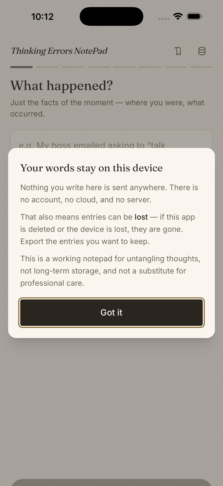
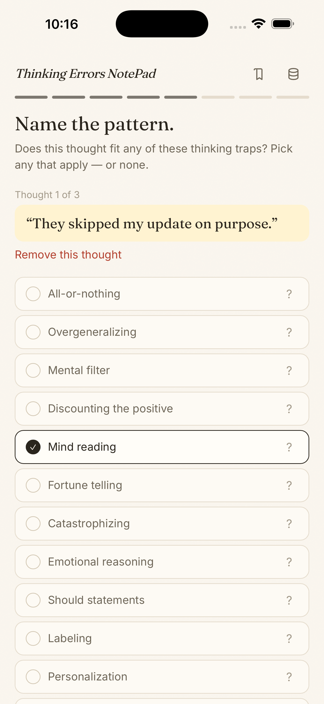
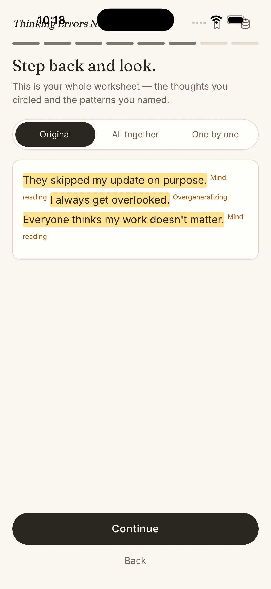
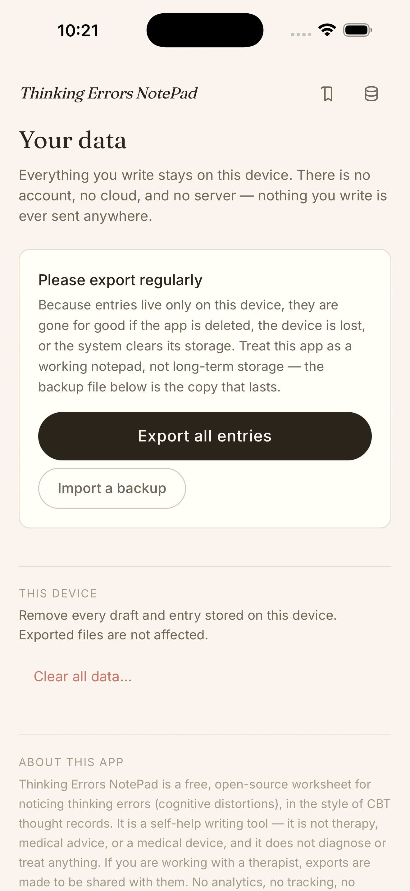

# Thought Record

**A private CBT thought-record worksheet for your phone. Nothing you write ever leaves the device.**

[App Store](https://apps.apple.com/us/app/thought-record-cbt-notes/id6788916753) · [Google Play](https://play.google.com/store/apps/details?id=com.urbanpyx.thinkingerrors) · [Privacy policy](PRIVACY.md) · MIT licensed

| | |
| --- | --- |
| **Problem** | Cognitive behavioral therapy (CBT) asks people to write out a stressful moment, circle the distorted thoughts, and reason toward a balanced one. Paper is good at this and phones are bad at it: most apps want an account, upload your most private writing to a server, or have an AI interpret it for you. |
| **Approach** | Copy the paper worksheet instead of reinventing it. One clear action per screen, no AI reading into your words, and a hard privacy line: no account, no server, no analytics, and no network requests at all. |
| **What it is** | A free, open-source app on iOS, Android and the web. It is one Next.js codebase exported as a static site and wrapped with Capacitor, so all three work fully offline. |
| **Status** | Live on the App Store and Google Play. |

<p>
  
  
  
  
</p>

## The problem

A CBT thought record is a simple exercise: describe the situation, name what
you felt, write out the thoughts in your head, spot the thinking errors
(cognitive distortions such as catastrophizing or mind reading), and finish
with a more balanced thought. On paper you write freely, circle phrases and
see the whole page at once. Digital versions tend to go wrong in one of three
ways. Some turn into clinical forms. Some chop your thoughts into fields
before you've finished thinking them. Some send the text to a server or a
model that interprets it for you. People write some of the most sensitive
things they will ever type in an app like this, so I treated privacy as a
product requirement, not a setting.

## How I approached it

- **Start from the paper worksheet.** You write one long passage first, then
  highlight phrases to "circle" them, then label each phrase with a thinking
  pattern, one at a time. A review step shows the original text, everything
  together, or one thought at a time. The first screen is the worksheet
  itself, with no landing page in the way.
- **Cut scope to earn trust.** The first plan included optional cloud
  history (Supabase auth and Postgres). I removed it before launch. With no
  server, there is no breach risk, no account to recover and no data policy
  to trust. The trade-off is stated plainly in the app: export your entries,
  because a lost device takes them with it.
- **Make "no network" provable, not promised.** The Android manifest drops
  the Internet permission entirely and excludes app data from cloud backup.
  The iOS and web builds make no requests. The privacy policy can say "we
  collect nothing" because the app has no way to.
- **Deterministic, not AI.** An optional "auto choose thoughts" helper
  splits on grammar and punctuation. It never interprets meaning, and it
  warns before replacing your own selections.
- **One codebase, three stores' worth of polish.** The same static export
  ships to the web, iOS (Capacitor) and Android. Release scripts handle
  signing, TestFlight upload and Play bundles, and the store listings and
  release checklists are versioned in `docs/`.

## What I built

- A guided worksheet: situation → feelings → thoughts → circle phrases →
  label thinking patterns → review → balanced thought.
- History, entry notes, and printable or JSON export. A "Your data" page
  backs up and restores every entry as one file.
- Drafts that autosave on the device, so nothing is lost mid-worksheet.
- Unit and flow tests (Vitest and Testing Library) for the reducer, phrase
  segmenter, feelings model, export and the worksheet flow.

**Stack:** Next.js (static export), React, TypeScript, Tailwind CSS,
IndexedDB, Capacitor (iOS and Android), Vitest.

---

## How your data is stored

| Choice | Where it lives | Who can see it |
| --- | --- | --- |
| **Save on this device** | On-device storage (IndexedDB) | Only this device |
| **Export (printable / JSON)** | A file you download | Whoever you give the file to |
| **Discard** | Nowhere | Nobody |

Drafts autosave to the device while you work so nothing is lost mid-worksheet;
they are never uploaded (there is nowhere to upload them to). The **Your data**
page can export every entry as one backup file and import it again later.

See [PRIVACY.md](PRIVACY.md) for the full posture.

## Run it locally

```bash
npm install
npm run dev
```

There is no configuration — no env vars, no keys, no services.

## Verify

```bash
npm run lint
npm run test
npm run build   # static export → out/
```

## iOS app (Capacitor)

The web app is statically exported and bundled into a Capacitor iOS shell —
the native app works fully offline.

```bash
npm run ios:doctor      # preflight: Xcode, signing config, project settings
npm run ios:release     # build web → sync into ios/ → bump build number
npm run ios:archive     # xcodebuild archive (App Store Connect API key auth)
npm run ios:upload      # upload the archive to App Store Connect
npm run ios:testflight  # all of the above in one go
```

The archive/upload steps need a local config file (never committed) at
`~/.thinking-errors-notepad/ios-release.env`:

```
ASC_KEY_ID=<App Store Connect API key id>
ASC_ISSUER_ID=<issuer id>
ASC_KEY_PATH=$HOME/.appstoreconnect/private_keys/AuthKey_<key id>.p8
```

App Store listing copy and release process live in
[docs/app-store/](docs/app-store/).

The app icon and splash are generated, not hand-drawn — edit
`scripts/generate-app-art.swift` and run `swift scripts/generate-app-art.swift`,
then `npx @capacitor/assets generate --ios`.

## Android / Google Play

The same offline static app is bundled into `android/`, package
`com.urbanpyx.thinkingerrors`, version 1.0.1 (version code 1).

```bash
npm run android:sync     # build web and copy into Android
npm run android:open     # optional: open Android Studio
npm run android:release  # checks, signed release bundle, native lint
```

Requires JDK 21 and Android SDK 36. Signing keys live outside the repo in
`~/.thinking-errors-notepad/`. Setup, upload status, and verification steps:
[Google Play release checklist](docs/google-play/release-checklist.md).
Google Play listing copy: [listing.md](docs/google-play/listing.md).

The Android manifest removes Internet permission and excludes app data from
cloud backup and device transfer. File exports use Android's local document
picker and do not need broad storage access.

The signed Android release passed API 36 emulator testing on September 24,
2026, including offline persistence and backup/printable exports. Google Play has
accepted the bundle and published the internal release, with no testers selected.
The production release and store listing were submitted September 24, 2026,
and the app is publicly listed on Google Play (checked November 13, 2026).
Intended audience is 13+, with no data collected or shared, in 177
countries/regions.

## License

[MIT](LICENSE) — free to use, copy, and adapt.
